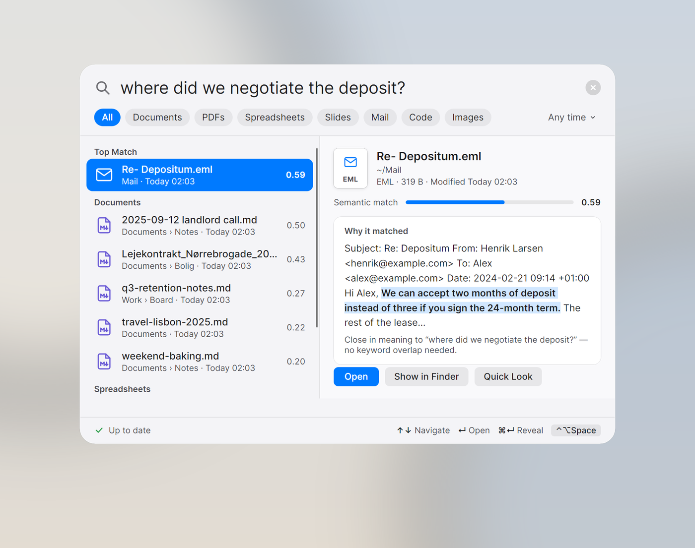
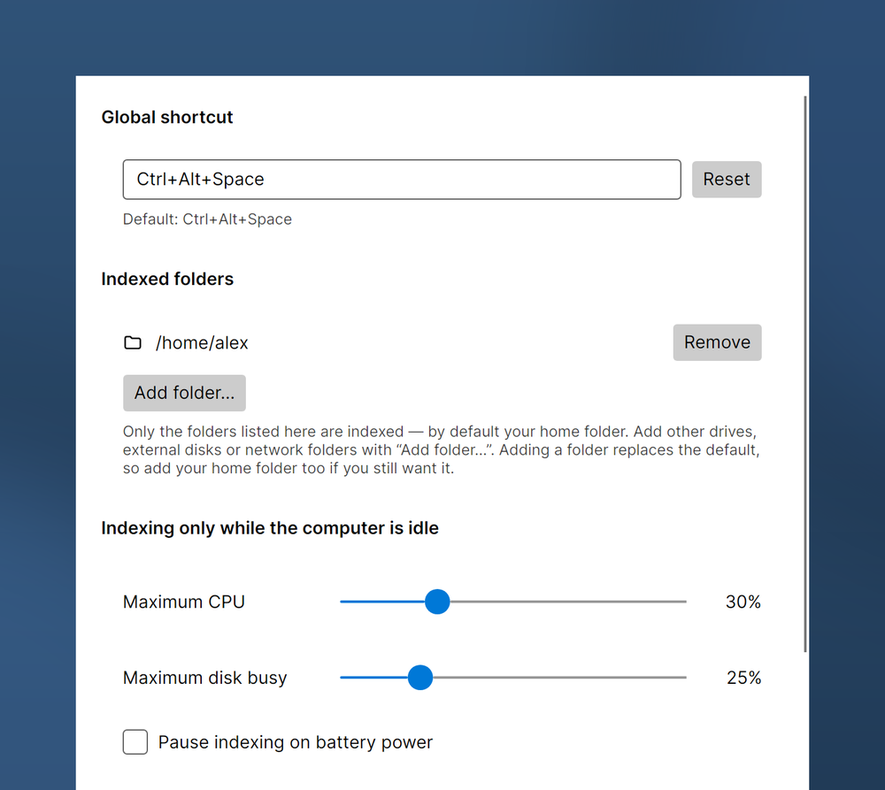
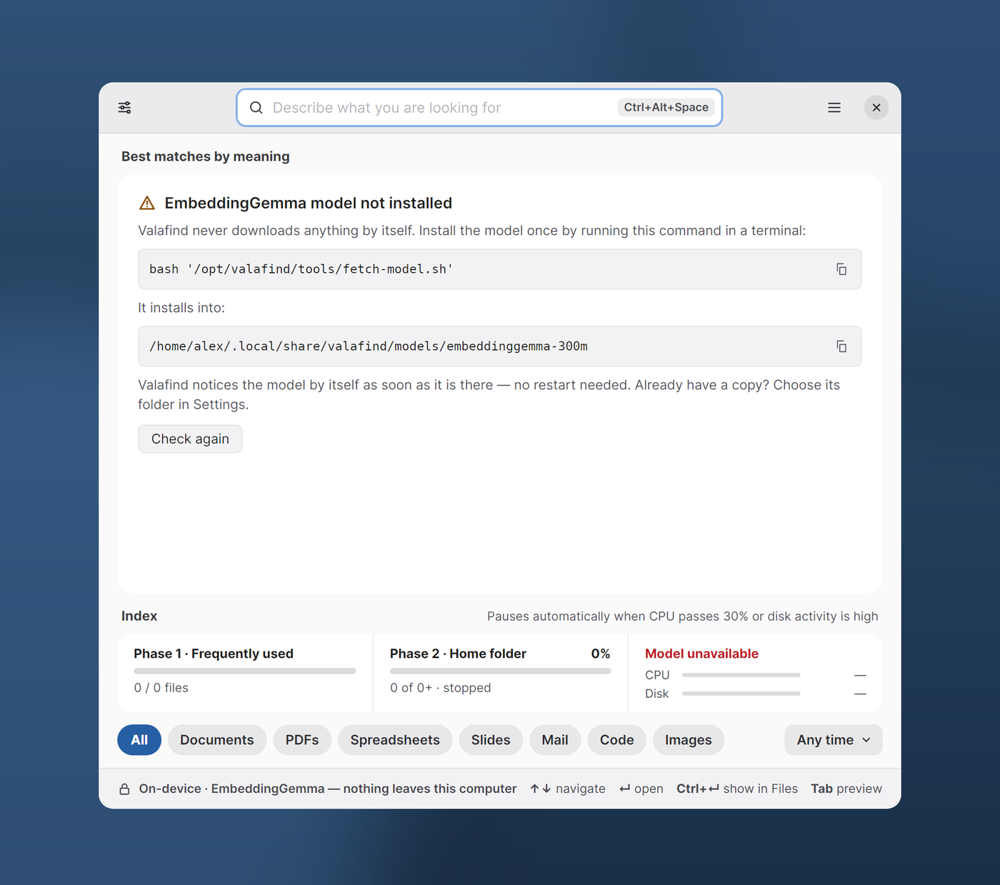

# Valafind

**Find files by what they mean.** Press <kbd>Ctrl</kbd>+<kbd>Alt</kbd>+<kbd>Space</kbd>, ask in your own words, and get the
file, even when it is written in another language and named `scan_0042.pdf`. Everything runs on your computer.

<table>
  <tr>
    <th>Windows</th>
    <th>macOS</th>
    <th>Linux</th>
  </tr>
  <tr>
    <td></td>
    <td></td>
    <td></td>
  </tr>
</table>

<p align="center"><sub>An English question finds a Danish lease and the landlord's e-mail. The highlighted sentence shows <i>why</i> it matched.</sub></p>

## Stays out of your way


Indexing pauses whenever the CPU or disk is busy and picks up again when they're idle. Files you use often are indexed
first (Phase 1), then the rest of your files (Phase 2). The progress panel only appears while indexing is under way;
once everything is indexed, the launcher just shows a small ✓ *Up to date*.



## Nothing leaves your computer

The [EmbeddingGemma](https://ai.google.dev/gemma/docs/embeddinggemma) model runs locally and is built into the app, so
there is nothing else to download. Valafind makes no network requests.

## Get it

Download the file for your platform from the [latest release](https://github.com/ffMathy/valafind/releases/latest). It is
a single executable with the model inside. Every merge to `main` publishes a new release.

| Platform | File |
|---|---|
| Windows (x64 / Arm64) | `valafind-win-x64.exe`, `valafind-win-arm64.exe` |
| macOS (Apple silicon / Intel) | `valafind-osx-arm64.app.zip`, `valafind-osx-x64.app.zip` (`Valafind.app`), or the bare `valafind-osx-*` executable |
| Linux (x64 / Arm64) | `valafind-linux-x64`, `valafind-linux-arm64` (`chmod +x` it first) |

Run it, and Valafind sits in the tray (menu bar on macOS) until you press the shortcut. On first start it unpacks the
model (~310 MB) into its data folder, which takes a second or two. `SHA256SUMS.txt` in each release lists the checksums.

<details>
<summary><b>Build from source</b></summary>

Download the model once (on Windows: `tools\fetch-model.ps1`), then publish with it built in:

```bash
tools/fetch-model.sh "$PWD/.model/embeddinggemma-300m"
dotnet publish src/Valafind.App -c Release -r linux-x64 --self-contained -p:PublishSingleFile=true \
  -p:ValafindModelDir="$PWD/.model/embeddinggemma-300m" -o publish
```

Runtimes: `win-x64`, `win-arm64`, `osx-arm64`, `osx-x64`, `linux-x64`, `linux-arm64`. For a macOS app bundle, run
`packaging/macos/make-app-bundle.sh publish dist`.

Leave out `-p:ValafindModelDir` for a smaller build without the model. It ships the `tools/fetch-model.*` scripts next
to the executable and, on first run, shows the command that installs the model; it notices the model without a restart.


</details>

<details>
<summary><b>Keyboard</b></summary>

| | |
|---|---|
| <kbd>Ctrl</kbd>+<kbd>Alt</kbd>+<kbd>Space</kbd> (⌃⌥Space on macOS) | Open / close (change it in Settings) |
| <kbd>↑</kbd> <kbd>↓</kbd> | Move through results |
| <kbd>Enter</kbd> | Open the file |
| <kbd>Ctrl</kbd>+<kbd>Enter</kbd> (⌘↵) | Show it in the file manager |
| <kbd>Tab</kbd> | Toggle the preview |
| <kbd>Esc</kbd> | Close |

**Wayland:** apps can't grab keys there. On KDE Plasma and GNOME 48+, Valafind asks the desktop to register the shortcut.
Elsewhere, bind your own shortcut to `<path-to-Valafind> --toggle`; Settings shows the exact command. For the desktop to
recognize the app, install `packaging/linux/app.valafind.Valafind.desktop` into `~/.local/share/applications/`.
</details>

<details>
<summary><b>What gets indexed</b></summary>

- **Content:** text, Markdown, code, HTML/JSON/XML/YAML, PDF, Word/Excel/PowerPoint, OpenDocument, EPUB, RTF, e-mail
  (`.eml`, `.mbox`) and Jupyter notebooks. Each document contributes up to its first ~32,000 characters.
- **Name only:** images (no OCR), audio, video, archives, legacy `.doc`/`.xls`/`.ppt`/`.msg`, and iWork files.
- **Skipped:** hidden and app-data folders, `node_modules`, `.git`, build output, caches, the Trash, and cloud
  placeholders that would trigger a download.

Embedding one chunk takes about half a second on two CPU threads, so a large home folder takes days of *idle* time to
index fully. That is why your everyday files go first.
</details>

<details>
<summary><b>Where your data lives</b></summary>

| OS | Folder |
|---|---|
| Windows | `%LOCALAPPDATA%\Valafind` |
| macOS | `~/Library/Application Support/Valafind` |
| Linux | `${XDG_DATA_HOME:-~/.local/share}/valafind` |

That folder holds `settings.json`, `index.db`, `models/` (the unpacked model) and `logs/`. The folder and its files are readable only by you,
because the index holds excerpts of your files. Delete `index.db` to rebuild the index, or set `VALAFIND_DATA_DIR` to
use a different folder.
</details>

<details>
<summary><b>Development</b></summary>

```bash
dotnet build Valafind.slnx
```

```bash
dotnet test --solution Valafind.slnx
```

Tests that need the real model, such as tokenizer and embedding parity and end-to-end search, run when you point them at
a model folder:

```bash
VALAFIND_TEST_MODEL_DIR=~/.local/share/valafind/models/embeddinggemma-300m dotnet test --solution Valafind.slnx
```

- `VALAFIND_UI=windows|mac|linux` switches the launcher design.
- `VALAFIND_SCREENSHOT_DIR=<dir>` makes `tests/Valafind.App.Tests` render the launchers headlessly.
- The code is in `src/Valafind.Core`: `Embedding`, `Extraction`, `Storage`, `Search`, `Indexing` and `Platform`. The
  Avalonia app is in `src/Valafind.App`; `src/Valafind.Model` embeds the model files when built with
  `-p:ValafindModelDir=…`.
</details>

---

<sub>Release binaries contain the unmodified EmbeddingGemma weights. Gemma is provided under and subject to the
[Gemma Terms of Use](https://ai.google.dev/gemma/terms) and the
[Gemma Prohibited Use Policy](https://ai.google.dev/gemma/prohibited_use_policy); each release includes this notice as
`NOTICE-Gemma.txt`.</sub>
