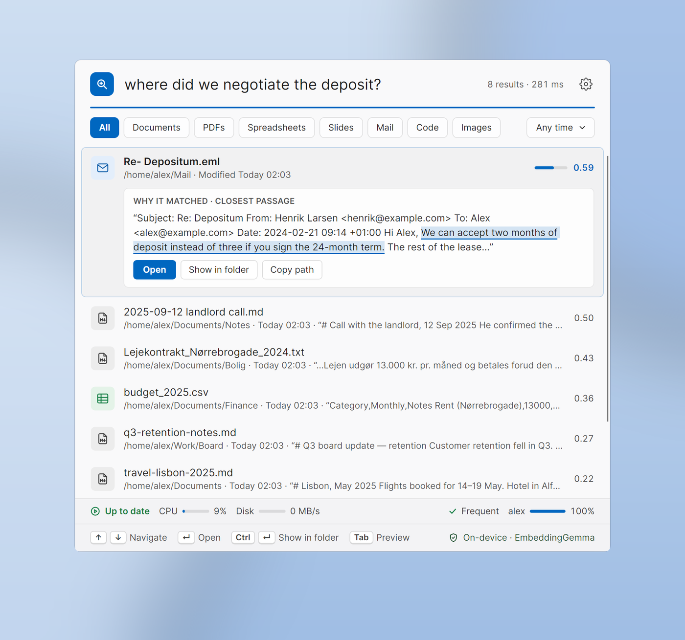
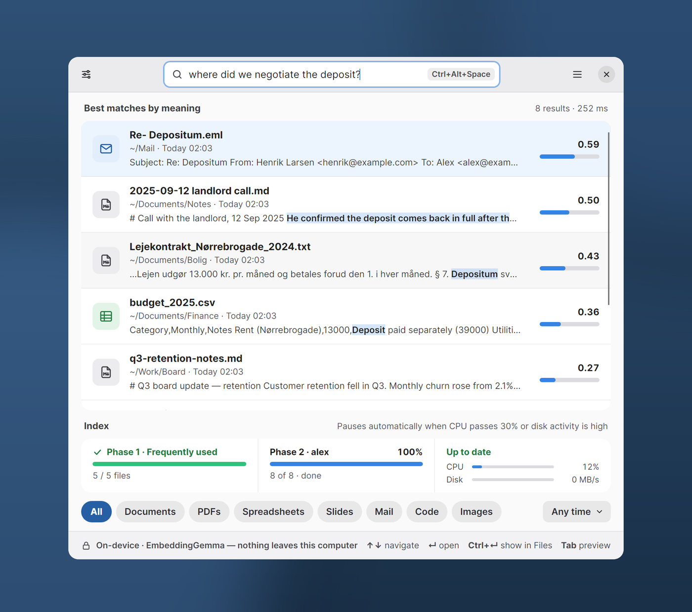
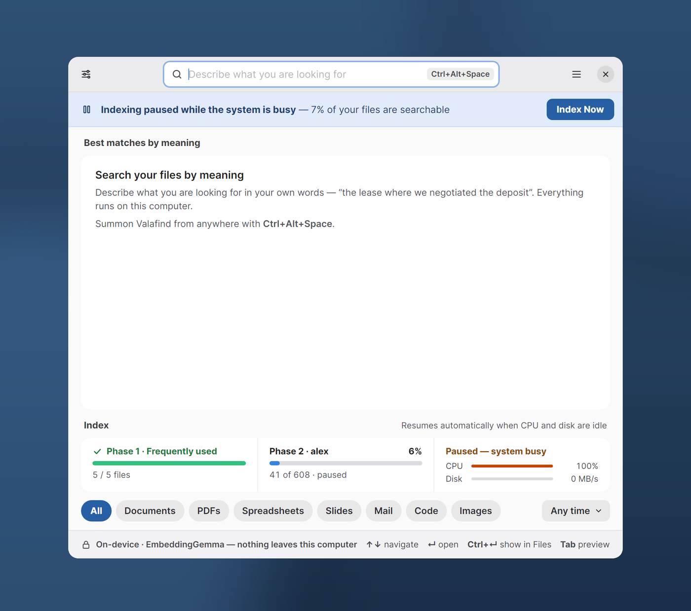

# Valafind

**Find files by what they mean.** Press <kbd>Ctrl</kbd>+<kbd>Alt</kbd>+<kbd>Space</kbd>, ask in your own words, and get the
file, even when it is written in another language and named `scan_0042.pdf`. Everything runs on your computer.

<p align="center">
  
</p>

<p align="center"><sub>An English question finds a Danish lease and the landlord's e-mail. The highlighted sentence shows <i>why</i> it matched.</sub></p>

## At home on every desktop

| Windows | Linux |
|:---:|:---:|
|  |  |

## Stays out of your way



Indexing pauses whenever the CPU or disk is busy and picks up again when they're idle. Files you use often are indexed
first (Phase 1), then the rest of your files (Phase 2).


## Nothing leaves your computer


The [EmbeddingGemma](https://ai.google.dev/gemma/docs/embeddinggemma) model runs locally. Valafind makes no network
requests. You download the model once, and Valafind notices it without a restart:

```bash
tools/fetch-model.sh
```

On Windows:

```powershell
powershell -ExecutionPolicy Bypass -File tools\fetch-model.ps1
```

## Get it

Download a build for your platform from the [CI artifacts](https://github.com/ffMathy/valafind/actions/workflows/ci.yml) (`valafind-win-x64`,
`valafind-osx-arm64`, `valafind-linux-x64`, …), run it, and install the model as shown above. Valafind sits in the tray
(menu bar on macOS) until you press the shortcut.

<details>
<summary><b>Build from source</b></summary>

```bash
dotnet publish src/Valafind.App -c Release -r linux-x64 --self-contained -p:PublishSingleFile=true -o publish
```

Runtimes: `win-x64`, `win-arm64`, `osx-arm64`, `osx-x64`, `linux-x64`, `linux-arm64`. For a macOS app bundle, run
`packaging/macos/make-app-bundle.sh publish dist`.
</details>

<details>
<summary><b>Keyboard</b></summary>

| | |
|---|---|
| <kbd>Ctrl</kbd>+<kbd>Alt</kbd>+<kbd>Space</kbd> (⌃⌥Space on macOS) | Open / close (change it in Settings) |
| <kbd>↑</kbd> <kbd>↓</kbd> | Move through results |
| <kbd>Enter</kbd> | Open the file |
| <kbd>Ctrl</kbd>+<kbd>Enter</kbd> (⌘↵) | Show it in the file manager |
| <kbd>Tab</kbd> | Toggle the preview |
| <kbd>Esc</kbd> | Close |

**Wayland:** apps can't grab keys there. On KDE Plasma and GNOME 48+, Valafind asks the desktop to register the shortcut.
Elsewhere, bind your own shortcut to `<path-to-Valafind> --toggle`; Settings shows the exact command. For the desktop to
recognize the app, install `packaging/linux/app.valafind.Valafind.desktop` into `~/.local/share/applications/`.
</details>

<details>
<summary><b>What gets indexed</b></summary>

- **Content:** text, Markdown, code, HTML/JSON/XML/YAML, PDF, Word/Excel/PowerPoint, OpenDocument, EPUB, RTF, e-mail
  (`.eml`, `.mbox`) and Jupyter notebooks. Each document contributes up to its first ~32,000 characters.
- **Name only:** images (no OCR), audio, video, archives, legacy `.doc`/`.xls`/`.ppt`/`.msg`, and iWork files.
- **Skipped:** hidden and app-data folders, `node_modules`, `.git`, build output, caches, the Trash, and cloud
  placeholders that would trigger a download.

Embedding one chunk takes about half a second on two CPU threads, so a large home folder takes days of *idle* time to
index fully. That is why your everyday files go first.
</details>

<details>
<summary><b>Where your data lives</b></summary>

| OS | Folder |
|---|---|
| Windows | `%LOCALAPPDATA%\Valafind` |
| macOS | `~/Library/Application Support/Valafind` |
| Linux | `${XDG_DATA_HOME:-~/.local/share}/valafind` |

That folder holds `settings.json`, `index.db`, `models/` and `logs/`. The folder and its files are readable only by you,
because the index holds excerpts of your files. Delete `index.db` to rebuild the index, or set `VALAFIND_DATA_DIR` to
use a different folder.
</details>

<details>
<summary><b>Development</b></summary>

```bash
dotnet build Valafind.slnx
```

```bash
dotnet test --solution Valafind.slnx
```

Tests that need the real model, such as tokenizer and embedding parity and end-to-end search, run when you point them at
a model folder:

```bash
VALAFIND_TEST_MODEL_DIR=~/.local/share/valafind/models/embeddinggemma-300m dotnet test --solution Valafind.slnx
```

- `VALAFIND_UI=windows|mac|linux` switches the launcher design.
- `VALAFIND_SCREENSHOT_DIR=<dir>` makes `tests/Valafind.App.Tests` render the launchers headlessly.
- The code is in `src/Valafind.Core`: `Embedding`, `Extraction`, `Storage`, `Search`, `Indexing` and `Platform`. The
  Avalonia app is in `src/Valafind.App`.
</details>

---

<sub>EmbeddingGemma is provided by Google under the [Gemma Terms of Use](https://ai.google.dev/gemma/terms). Valafind does
not redistribute the model weights.</sub>
