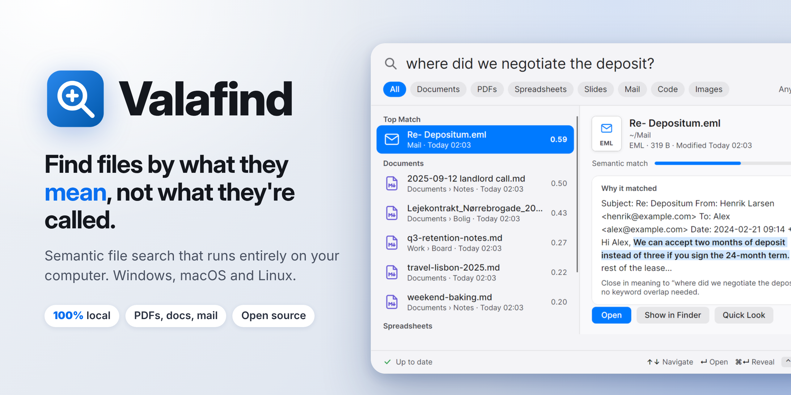
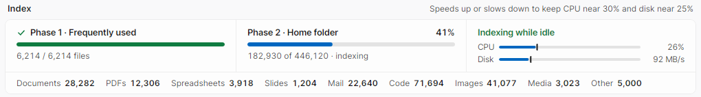

# Valafind

<p align="center"></p>

**Find files by what they mean.** Press <kbd>Ctrl</kbd>+<kbd>Alt</kbd>+<kbd>Space</kbd>, ask in your own words, and get the
file, even when it is written in another language and named `scan_0042.pdf`. Everything runs on your computer.

<table>
  <tr>
    <th>Windows</th>
    <th>macOS</th>
    <th>Linux</th>
  </tr>
  <tr>
    <td></td>
    <td></td>
    <td></td>
  </tr>
</table>

<p align="center"><sub>An English question finds a Danish lease and the landlord's e-mail. The highlighted sentence shows <i>why</i> it matched.</sub></p>

## Stays out of your way



Indexing uses the CPU and disk your computer isn't using, up to the limits you set in Settings (30 % CPU and 25 % disk
by default). It speeds up when the machine is quiet, works on several files at once on a multi-core machine, and slows
down as other programs get busy. Two feedback (PID) controllers watch total CPU and disk activity every two seconds and
keep both just under their limits; the tick on each meter in the index panel marks that target. It never pauses for
load: when the machine is busy it slows to a trickle instead. Only you (or unplugging, if you turned on *pause on
battery*) pause it. Files you use often are indexed
first (Phase 1), then the rest of your files (Phase 2). Within that, Valafind always goes **documents → pictures → audio →
video**: everything you write and read is searchable before it starts on your photo library, and the slow video work
comes last. The progress panel only appears while indexing is under way; once everything is indexed, the launcher just
shows a small ✓ *Up to date*.


## Nothing leaves your computer

The [EmbeddingGemma 2](https://huggingface.co/google/embeddinggemma-2) model runs locally and is built into the app, so
there is nothing else to download. It puts text, pictures, audio and video in one space, so *"a red car in the snow"*
finds the photo and *"the meeting where we talked about the budget"* finds the voice memo. Your files, the index and your searches never leave your computer. The only network
request Valafind makes is checking GitHub for a newer release every few hours (see below); turn that off in Settings.

## Get it

Download the file for your platform from the [latest release](https://github.com/ffMathy/valafind/releases/latest). It is
a single executable with the model inside. Every merge to `main` publishes a new release.

| Platform | File |
|---|---|
| Windows (x64 / Arm64) | `valafind-win-x64.exe`, `valafind-win-arm64.exe` |
| macOS (Apple silicon / Intel) | `valafind-osx-arm64.app.zip`, `valafind-osx-x64.app.zip` (`Valafind.app`), or the bare `valafind-osx-*` executable |
| Linux (x64 / Arm64) | `valafind-linux-x64`, `valafind-linux-arm64` (`chmod +x` it first) |

Run it, and Valafind installs itself for your user (no administrator rights), sets itself to start at login and sits in
the tray (menu bar on macOS) until you press the shortcut. On first start it unpacks the model (~850 MB) into its data
folder, which takes a few seconds. `SHA256SUMS.txt` in each release lists the checksums.

<details>
<summary><b>Installing, updating and uninstalling</b></summary>

| OS | Installed to | Also |
|---|---|---|
| Windows | `%LOCALAPPDATA%\Programs\Valafind` | Start menu shortcut, entry in Apps and Control Panel |
| macOS | `~/Applications/Valafind.app` | |
| Linux | `~/.local/bin/valafind` | desktop entry `app.valafind.Valafind.desktop` in `~/.local/share/applications` |

Valafind checks the latest GitHub release a minute after it starts and every six hours after that. A newer version
is downloaded, checked against its published SHA-256 and put in place of the running one, and Valafind restarts into
it once the launcher and Settings are closed. Turn this off in Settings, or set `VALAFIND_NO_UPDATE=1`; **Check for
updates** in the tray menu and Settings checks right away.

The update that moved Valafind from EmbeddingGemma-300m (text only) to EmbeddingGemma 2 builds the index again from
scratch, because the two models' vectors are not comparable. It removes the old model folder (`models/embeddinggemma-300m`).

Start it with `--no-install` (or set `VALAFIND_NO_INSTALL=1`) to run a copy where it is. Uninstall it from Apps or
Control Panel on Windows, or run it with `--uninstall` anywhere; your settings and index stay in the data folder.
</details>

<details>
<summary><b>Build from source</b></summary>

Download the model once (on Windows: `tools\fetch-model.ps1`), then publish with it built in:

```bash
tools/fetch-model.sh "$PWD/.model/embeddinggemma-2"
dotnet publish src/Valafind.App -c Release -r linux-x64 --self-contained -p:PublishSingleFile=true \
  -p:ValafindModelDir="$PWD/.model/embeddinggemma-2" -o publish
```

Runtimes: `win-x64`, `win-arm64`, `osx-arm64`, `osx-x64`, `linux-x64`, `linux-arm64`. For a macOS app bundle, run
`packaging/macos/make-app-bundle.sh publish dist`.

A single-file build installs itself on first start and updates to the latest release. While trying out such a build,
start it with `--no-install` and set `VALAFIND_NO_UPDATE=1`. `dotnet run` and the tests are never installed or updated.

Leave out `-p:ValafindModelDir` for a smaller build without the model. It ships the `tools/fetch-model.*` scripts next
to the executable and, on first run, shows the command that installs the model; it notices the model without a restart.


</details>

<details>
<summary><b>Keyboard</b></summary>

| | |
|---|---|
| <kbd>Ctrl</kbd>+<kbd>Alt</kbd>+<kbd>Space</kbd> (⌃⌥Space on macOS) | Open / close (change it in Settings) |
| <kbd>↑</kbd> <kbd>↓</kbd> | Move through results |
| <kbd>Enter</kbd> | Open the file |
| <kbd>Ctrl</kbd>+<kbd>Enter</kbd> (⌘↵) | Show it in the file manager |
| <kbd>Tab</kbd> | Toggle the preview |
| <kbd>Esc</kbd> | Close |

**Wayland:** apps can't grab keys there. On KDE Plasma and GNOME 48+, Valafind asks the desktop to register the shortcut.
Elsewhere, bind your own shortcut to `valafind --toggle` (`~/.local/bin/valafind`); Settings shows the exact command.
The desktop recognizes the app through the desktop entry the installer writes.
</details>

<details>
<summary><b>What gets indexed</b></summary>

- **Text:** text, Markdown, code, HTML/JSON/XML/YAML, PDF, Word/Excel/PowerPoint, OpenDocument, EPUB, RTF, e-mail
  (`.eml`, `.mbox`) and Jupyter notebooks, embedded by their text. Each document contributes up to its first ~32,000
  characters.
- **Pictures** (PNG, JPEG, GIF, BMP, WebP; HEIC/HEIF and TIFF on macOS): what they show, including text in them.
- **Audio** (WAV everywhere; MP3, AAC/M4A, FLAC, … through the system's codecs): what is said or heard, as up to four
  30-second clips, spread over the file when it is longer than two minutes.
- **Video**: eight frames spread over the video, plus up to two 30-second clips of its sound.
- **Name only:** archives, legacy `.doc`/`.xls`/`.ppt`/`.msg`, iWork files, and media no decoder can read.
- **Online-only cloud files** (OneDrive Files On-Demand, iCloud Drive, Dropbox, Google Drive, …): downloaded one at
  a time, indexed like any other file, then made online-only again, so they take no space on your disk. Files you
  keep on the device ("Always keep on this device") stay downloaded. Documents over 64 MB, media over 1 GB, and any
  file that would leave less than 2 GB free are indexed by name until they are on your device. On macOS, a provider
  that refuses to take a file back is not downloaded from again; its files are indexed by name.
- **Skipped:** hidden and app-data folders, `node_modules`, `.git`, build output, caches and the Trash.

Pictures, audio and video are also findable by their names. Audio and video use Media Foundation on Windows and
AVFoundation on macOS. On Linux they need `ffmpeg` (`sudo apt install ffmpeg`, `sudo dnf install ffmpeg`, …); without
it, audio other than WAV and video are indexed by name only.

With a graphics card, the model runs on the GPU (WebGPU: Direct3D 12 on Windows, Vulkan on Linux, Metal on Apple
silicon; no CUDA or other toolkit needed). On a GTX 1070 that takes about 70 ms per text chunk, a third of a second per
picture and well under a second per 30-second audio clip, 10 to 20 times faster than the CPU. Without a usable GPU it runs on the
CPU: about a second per text chunk on two threads, five seconds per picture and seven per audio clip. Valafind runs as many
of these at once as your CPU limit leaves room for, but on the CPU a large home folder can still take days of *idle* time
to index fully. That is why your everyday files and your documents go first. `"UseGpu": false` in `settings.json` keeps
the model on the CPU; the log's *Core services ready* line says where it runs.
</details>

<details>
<summary><b>Languages</b></summary>

Valafind speaks 21 languages: English, Chinese (Simplified), Hindi, Spanish, Arabic, French, Bengali, Portuguese,
Russian, Indonesian, Urdu, German, Japanese, Marathi, Vietnamese, Telugu, Hausa, Turkish, Tamil, Korean and Danish.
It follows your operating system's language; pick another one under **Settings → General → Language** (applies at the next start).
Arabic and Urdu use a right-to-left layout.

Searching works across languages regardless of the UI language: EmbeddingGemma matches meaning, not words.
</details>

<details>
<summary><b>Where your data lives</b></summary>

| OS | Folder |
|---|---|
| Windows | `%LOCALAPPDATA%\Valafind` |
| macOS | `~/Library/Application Support/Valafind` |
| Linux | `${XDG_DATA_HOME:-~/.local/share}/valafind` |

That folder holds `settings.json`, `index.db`, `models/` (the unpacked model) and `logs/`. The folder and its files are readable only by you,
because the index holds excerpts of your files. Delete `index.db` to rebuild the index, or set `VALAFIND_DATA_DIR` to
use a different folder.
</details>

<details>
<summary><b>Development</b></summary>

```bash
dotnet build Valafind.slnx
```

```bash
dotnet test --solution Valafind.slnx
```

Tests that need the real model, such as tokenizer and embedding parity (text, pictures, audio and video against
`tools/make-embedding-reference.py`) and end-to-end search, run when you point them at a model folder:

```bash
VALAFIND_TEST_MODEL_DIR=~/.local/share/valafind/models/embeddinggemma-2 dotnet test --solution Valafind.slnx
```

Add `VALAFIND_TEST_GPU=1` to also check that the GPU (WebGPU) produces the same vectors as the CPU.

`tools/Valafind.Bench` times every stage of indexing (extraction, chunking, embedding, media decoding) per file, on a
sample of your own files or on a fixed workload, on the CPU or the GPU:

```bash
dotnet run -c Release --project tools/Valafind.Bench -- --micro --provider gpu --compare <model folder>
```

- `VALAFIND_UI=windows|mac|linux` switches the launcher design.
- UI text lives in `src/Valafind.App/Localization/Strings.resx` (English) and `Strings.<culture>.resx` (translations).
  Add a text to every file; `LocalizationTests` fails when a translation misses a text or a `{0}` placeholder.
- `VALAFIND_SCREENSHOT_DIR=<dir>` makes `tests/Valafind.App.Tests` render the launchers headlessly.
- The code is in `src/Valafind.Core`: `Embedding`, `Extraction`, `Storage`, `Search`, `Indexing` and `Platform`. The
  Avalonia app is in `src/Valafind.App`; `src/Valafind.Model` embeds the model files when built with
  `-p:ValafindModelDir=…`.
</details>

---

<sub>Release binaries contain the EmbeddingGemma 2 weights (8-bit ONNX export by onnx-community) by Google DeepMind,
licensed under the [Apache License 2.0](https://www.apache.org/licenses/LICENSE-2.0); use must also follow the
[Gemma Prohibited Use Policy](https://ai.google.dev/gemma/prohibited_use_policy). Each release includes this notice as
`NOTICE-Gemma.txt`.</sub>
